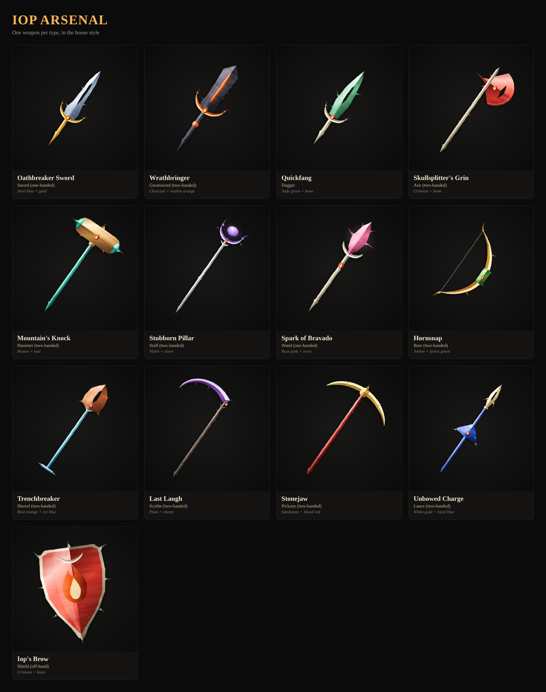

# Iop Arsenal

One weapon for every weapon type, painted in the house style from the reference art. All designs are original.

| # | Name | Type | Colors |
|---|------|------|--------|
| 01 | Oathbreaker Sword | Sword (one-handed) | Steel blue + gold |
| 02 | Wrathbringer | Greatsword (two-handed) | Charcoal + molten orange |
| 03 | Quickfang | Dagger | Jade green + bone |
| 04 | Skullsplitter's Grin | Axe (two-handed) | Crimson + bone |
| 05 | Mountain's Knock | Hammer (two-handed) | Bronze + teal |
| 06 | Stubborn Pillar | Staff (two-handed) | Violet + silver |
| 07 | Spark of Bravado | Wand (one-handed) | Rose pink + ivory |
| 08 | Hornsnap | Bow (two-handed) | Amber + forest green |
| 09 | Trenchbreaker | Shovel (two-handed) | Rust orange + ice blue |
| 10 | Last Laugh | Scythe (two-handed) | Plum + ebony |
| 11 | Stonejaw | Pickaxe (two-handed) | Sandstone + blood red |
| 12 | Unbowed Charge | Lance (two-handed) | White gold + royal blue |
| 13 | Iop's Brow | Shield (off-hand) | Crimson + bone |

## Files

- `png/`: 1024×1024 renders on the dark background
- `png-transparent/`: the same renders with a transparent background, for in-game icons
- `svg/`: vector sources
- `generate.js`: the generator. Edit a palette or shape, then run `node generate.js` (needs Playwright) to re-render everything.

## Style rules taken from the reference

1. **Two-tone faceting.** Every blade, haft and guard is split down a center ridge into a lit plane (warm highlight) and a shadow plane. There are no black outlines.
2. **Two-material palette.** Each weapon has one main material plus one accent material for the guard, grip and pommel.
3. **Thorn spikes.** Small curved thorns stick out of edges and hafts.
4. **Hooked crescent guards.** Guards are crescents whose tips hook back toward the blade.
5. **Spike pommels.** Hilts and hafts end in a long tapered point.
6. **Cut-through slots.** Blades have open slots like the split blade in the reference.
7. **Painterly finish.** Soft mottled texture, slightly rough edges, near-black background, displayed diagonally.

On top of that, every weapon carries a small **Iop flame-tuft emblem** so the set reads as one class's arsenal.

## Research notes: Iop and weapon types

- **Who the Iop is.** In Ankama's Krosmoz (Dofus and Wakfu), Iop is the god of war. The Iop class is a reckless melee fighter: very high damage per turn, a lot of pride, and always looking for a fight. Its spells are mostly about swords (Sword of Iop, Sword of Fate, Celestial Sword, Sword of Judgement, Iop's Wrath), plus Pressure, Jump, Cut and Concentration. The class mainly scales with Strength/Earth. It was designed around **swords**, and older Dofus versions gave Iops a sword damage bonus. That's why the set has two swords and a sword-styled spike on every pommel.
- **Weapon types in Dofus:** swords, daggers, axes, hammers, staffs, wands, bows, shovels, pickaxes, scythes (added around 2.6x) and lances (added in 2.66, they hit a 4-cell line).
- **Weapon slots in Wakfu:** one-handed weapons (sword, wand, staff) go in the right hand. Two-handed weapons (sword, axe, hammer, bow, shovel, staff) take both hands. Daggers and shields are off-hand items.
- Combining both games gives the 13 types in this set. A Dofus Iop can use any weapon type, but its kit pushes it toward swords, axes and hammers. A Wakfu Iop is the one-handed sword user with a shield or dagger.
